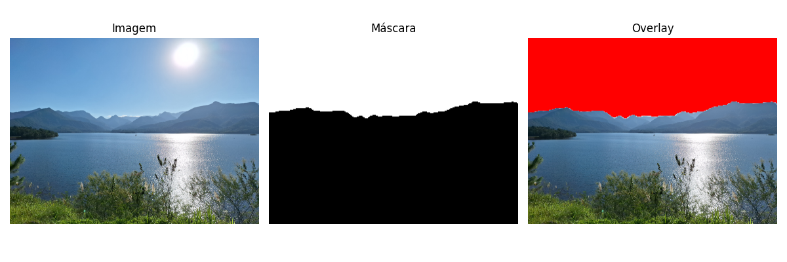
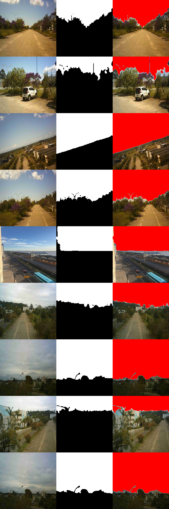
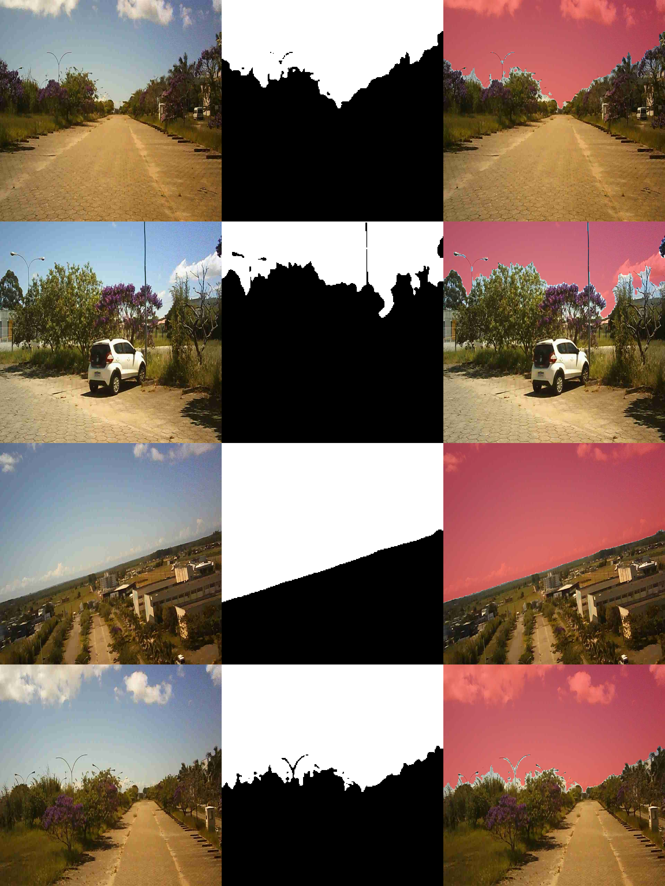
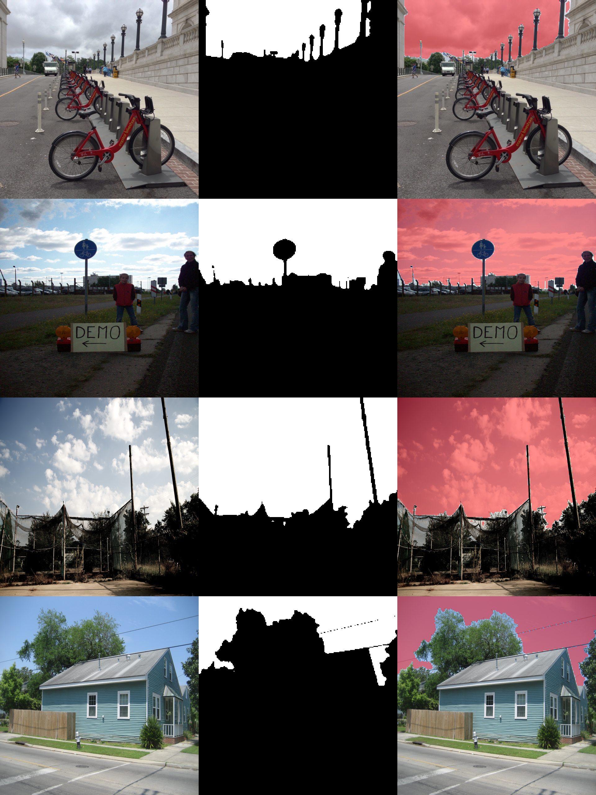

# Sky Segmentation for Embedded Systems

This repository contains training and inference code for sky segmentation models focused on embedded deployment.

## What is included

- TensorFlow training pipeline for the WNet/U2Net-style model.
- ONNX inference scripts for TensorFlow-trained WNet:
- `infer_wnet_tf2onnx_image.py` and `infer_wnet_tf2onnx_video.py`.
- ONNX inference scripts for PyTorch-trained DeepLab (custom normalization):
- `infer_deeplab_wnet_pytorch2onnx_folder.py` and `infer_deeplab_wnet_pytorch2onnx_video.py`.
- Model weights and experiment outputs under `weights/` and `training/`.

## Quick start

```bash
pip install -r requirements.txt
```

Run one of the scripts inside `inference/` according to your input type (image, video, or folder).

## Results

Images below are stored in `docs/docs_imgs_results`:






