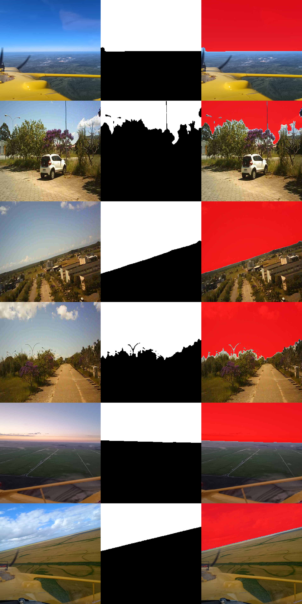

# Sky Segmentation for Embedded Systems

## Results

Images are stored in `docs/docs_imgs_results`:



## Quick start

Create and activate a virtual environment, then install the dependencies:

```bash
python -m venv .venv
source .venv/bin/activate    # Linux/macOS (Windows: .venv\Scripts\activate)
pip install -r requirements.txt
```

Run the single-image WNet inference:

```bash
python inference/infer_wnet_tf2onnx_image.py
```

Run the DeepLab image inference:

```bash
python inference/infer_deeplab_wnet_pytorch2onnx_image.py
```

Both scripts process one image. Edit `image_input_path` and `model_path` at the top of the script before running. For the WNet model, use `weights/Wolosky_Net.onnx`.

## Overview

In this repository, WNet refers to WoloskyNet.

This project performs binary sky segmentation on RGB images. It takes one image and returns a pixel-wise mask that separates sky from the rest of the scene, thresholded at 0.5.

The repository covers training and export for two model families: WNet/U2Net in TensorFlow/Keras and DeepLabV3 MobileNetV2/ResNet34 in PyTorch. The models are exported to ONNX for single-image inference on a PC. The WNet model also has FP32 and INT8 TFLite versions. The embedded runtime is not included in this repository.

## Paper

Sky Segmentation with Deep Learning for Embedded Systems. 39th Conference on Graphics, Patterns and Images (SIBGRAPI 2026).

- Paper: <http://sibgrapi.sid.inpe.br/col/sid.inpe.br/sibgrapi/2026/08.27.13.20/doc/thisInformationItemHomePage.html>
- PDF: <http://sibgrapi.sid.inpe.br:80/col/sid.inpe.br/sibgrapi/2026/08.27.13.20/doc/SIBGRAPI2026___WNet__CR_.pdf>

## What is included

- TensorFlow training pipeline for the WNet/U2Net-style model.
- ONNX image inference for the TensorFlow-trained WNet in `inference/infer_wnet_tf2onnx_image.py`.
- ONNX image inference for the PyTorch-trained DeepLab models in `inference/infer_deeplab_wnet_pytorch2onnx_image.py`.
- Model weights in `weights/`.
- Training notebooks, plots and exported models in `training/`.

## Repository structure

```text
inference/                       single-image inference scripts and test images
training/Wolosky-Net/            WNet notebook, plots, Keras, ONNX and TFLite weights
training/Wolosky-Net-DeepLabV3/  DeepLab notebooks and ONNX weights
weights/                         ONNX models ready for inference
docs/docs_imgs_results/          result images
requirements.txt                 inference dependencies
```

## Dataset

Training used the Sky Segmentation WoloskyNet dataset: 27,374 image/mask pairs at 320×320, with binary masks (0/255) generated by SAM3 using the prompt `sky` and a confidence threshold of 0.4.

Dataset: <https://huggingface.co/datasets/vinimuchulski/sky-segmentation-wolosky-net>

The training notebook uses a 70% training, 15% validation and 15% test split with seed 42. The manifest provides `image_path` and `mask_path` for each sample. Access may require authorization while the dataset is private.

## Available weights

- `weights/Wolosky_Net.onnx`
- `weights/Sky_Unet_DeepLab_v1_MobileNetv2_infer.onnx`
- `weights/Sky_Unet_DeepLab_v2_Resnet34_infer.onnx`
